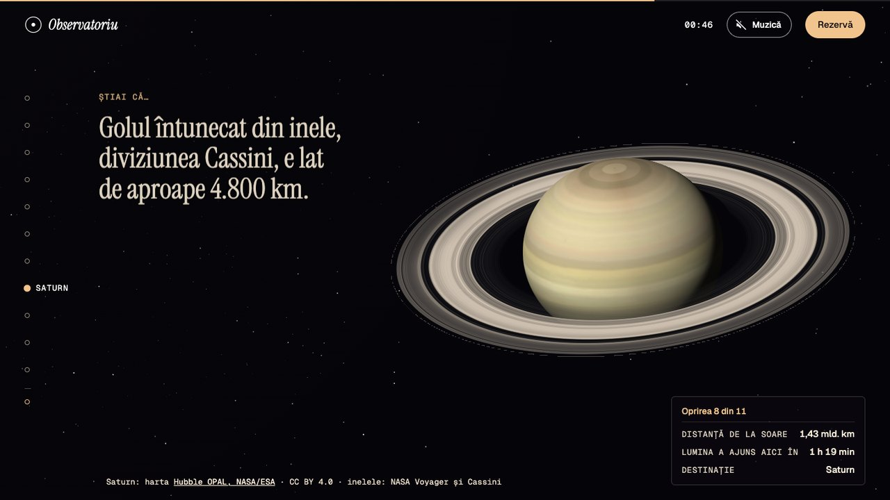

# Observatoriu — o seară prin Sistemul Solar

> **In English:** a scroll-driven one-page site for a fictional planetarium. As you scroll, the evening goes from a sunset photographed from the International Space Station to past midnight, following sunlight past all eight planets and the Moon. Plain HTML, CSS and JavaScript (no framework). The Sun, the planets and the Moon are rendered live in WebGL2 from real NASA, ESA and JAXA maps. Only the opening sunset is an image sequence. Assets load progressively. Lighthouse mobile scores 100 in all four categories. The full journey downloads about 20 MB on desktop and 7 MB on phones, down from 300 MB and 50 MB in the first version, and it scrolls at 60 fps. The planetarium, prices and events are fictional; the astronomical data is real.


## Ce e

Un planetariu **fictiv** și o seară întreagă pe o singură pagină. Derularea controlează totul. Pornești de la un apus fotografiat de pe Stația Spațială Internațională, treci prin ocularul telescopului și mergi spre exterior, pe urma luminii Soarelui: Mercur, Venus, Pământul, Luna, Marte, Jupiter, Saturn, Uranus și Neptun. La fiecare oprire afli câteva lucruri despre corpul respectiv. Ceasul din colț arată ora reală a serii, de la 19:12 până la 02:00. La final ai programul serilor și un bilet de rezervare.

> **Planetariul, prețurile și evenimentele sunt fictive.** Datele astronomice sunt reale: distanțele, timpul în care lumina ajunge la fiecare planetă, faza Lunii și cerul din seara curentă, calculate cu Astronomy Engine.



## Cum e făcut

- **HTML, CSS și JavaScript simplu**, fără framework și fără pas de build. Fișierele din repository sunt exact cele publicate.
- **Planetele, Luna și Soarele se desenează live în WebGL2.** Hărți echirectangulare reale sunt înfășurate pe sfere de un shader propriu, cu:
  - lumină și terminator moale, atmosferă și turtire;
  - inelele lui Saturn, calculate din profilul de opacitate Voyager, cu umbrele planetei și ale inelelor;
  - norii Pământului pe un strat separat și reflexia Soarelui pe ape;
  - pe Soare, granulație animată și protuberanțe.
  
  Totul rulează într-un singur context WebGL, compus într-un canvas 2D.
- **Secvență de imagini doar pentru apus:** 70 de fotografii ISS, cu praful șters, stabilizate pe linia orizontului și decupate separat pentru calculator și pentru telefon. Între fotografii, imaginea trece lin dintr-una în alta.
- **Încărcare treptată:** la pornire, doar primele cadre ale apusului. Hărțile vin abia după prima derulare, în ordinea drumului: corpul curent, următorul, cel de după. Cele rămase în urmă se eliberează din memoria GPU. Telefoanele primesc hărți și cadre mai mici.
- **Accesibilitate:** navigare din tastatură, focus vizibil, contrast de cel puțin 4,5:1 pentru texte, mod pentru mișcare redusă și rezervă statică fără WebGL.
- **Cifrele** (cache golit; măsurate local cu gzip, ca pe Cloudflare):

  | | prima versiune | acum |
  |---|---|---|
  | tot drumul, calculator | ~300 MB | **~20 MB** |
  | tot drumul, telefon | ~50 MB | **~7 MB** |
  | la deschidere | 20 MB / 3,5 MB | **2,2 MB / 1,2 MB** |
  | Lighthouse mobil | — | **100 / 100 / 100 / 100**, LCP 0,6 s, TBT 0, CLS 0 |
  | derulare | — | **60 fps** (p95 ≈ 16,7 ms, și pe telefon cu procesorul încetinit de 4×) |

## Structura

```
index.html          pagina (CSS critic în <head>)
css/style.css       restul stilurilor, încărcat după primul cadru
js/main.js          pornirea: primele cadre, apoi restul aplicației
js/app.js           derularea, textele, ceasul, cuprinsul, programul și biletul
js/journey.js       drumul: camera, stelele, asteroizii, opririle
js/globe.js         randarea WebGL2 a sferelor (shaderul)
js/frames.js        cadrele apusului: descărcare cu priorități, decodare, estompare
js/vendor/          Astronomy Engine (MIT)
media/              hărți (tex/), cadre (d/ calculator, m/ telefon), imagini statice, video
_headers            cache lung pentru /media/* și /fonts/*, fără cache pentru HTML (Cloudflare Pages)
```

Ca să-l rulezi local, pornește orice server static din folderul proiectului, de exemplu `python3 -m http.server 8080`, apoi deschide `http://localhost:8080`. Cu `?debug` în adresă, consola raportează încălcările de ritm (cadre lungi, descărcări în afara ordinii).

## Surse și licențe

| Ce | Sursa | Licența |
|---|---|---|
| Apusul de început | 70 de fotografii time-lapse ale echipajului Expediției 30, ISS030-E-235760 – 235829, 13 aprilie 2012, [NASA Crew Earth Observations](https://eol.jsc.nasa.gov/BeyondThePhotography/CrewEarthObservationsVideos/) | domeniu public |
| Soarele | [NASA/SDO](https://sdo.gsfc.nasa.gov/), HMI Intensitygram 4096² și AIA 304, 9 mai 2024, prin [Helioviewer](https://helioviewer.org/) | domeniu public |
| Mercur | [MESSENGER MDIS](https://astrogeology.usgs.gov/search/map/mercury_messenger_mdis_basemap_md3_color_global_mosaic_665m) (NASA/JHUAPL/Carnegie) | domeniu public |
| Venus | [Akatsuki UVI](https://doi.org/10.17597/isas.darts/vco-00016) (JAXA/ISAS) | CC BY 4.0 |
| Pământul | [Blue Marble Next Generation](https://science.nasa.gov/earth/earth-observatory/blue-marble-next-generation/) și Blue Marble: Clouds, NASA Earth Observatory | domeniu public |
| Luna | [CGI Moon Kit](https://svs.gsfc.nasa.gov/4720), harta color LROC (NASA SVS) | domeniu public |
| Marte | [Viking MDIM 2.1](https://astrogeology.usgs.gov/search/map/mars_viking_colorized_global_mosaic_232m) (NASA/USGS) | domeniu public |
| Jupiter | [Cassini PIA07782](https://photojournal.jpl.nasa.gov/catalog/PIA07782) (NASA/JPL/SSI) | domeniu public |
| Saturn, Uranus, Neptun | [Hubble OPAL](https://doi.org/10.17909/T9G593) (NASA/ESA/STScI, programul OPAL, PI A. Simon) | CC BY 4.0 |
| Inelele lui Saturn | [Voyager 2 PPS](https://pds-rings.seti.org/) (NASA PDS Rings Node) și [Cassini PIA08389](https://photojournal.jpl.nasa.gov/catalog/PIA08389) | domeniu public |
| Stelele căzătoare de la final | video [ESO/Gianluca Lombardi](https://www.eso.org/public/videos/Geminidstimelapse4/) (glphoto.it) | CC BY 4.0 |
| Calculele astronomice | [Astronomy Engine](https://github.com/cosinekitty/astronomy) (Don Cross) | MIT |
| Fonturile | [Instrument Serif](https://github.com/Instrument/instrument-serif), [Geist și Geist Mono](https://github.com/vercel/geist-font) | SIL OFL 1.1 |

**Modificări față de surse:** cadre extrase, decupate și comprimate; praful șters de pe fotografiile ISS; Soarele, planetele și Luna randate live din hărți, cu culorile corectate. Proiectul nu are nicio legătură cu NASA, ESA, ESO sau JAXA și nu e susținut de ele.
