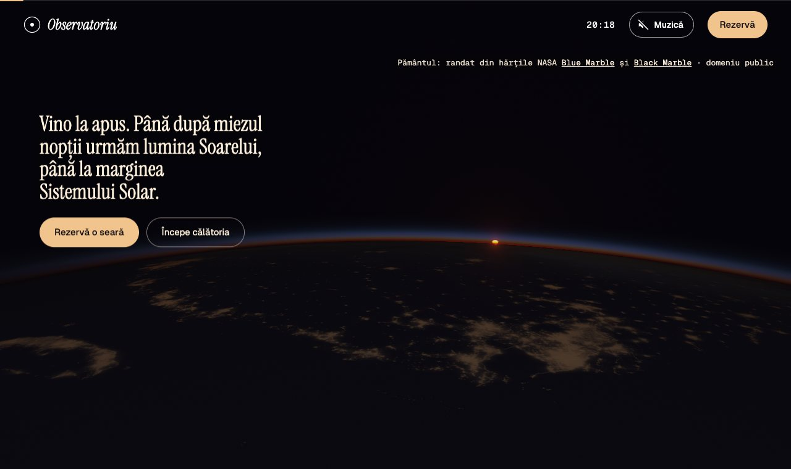

# Observatoriu: o seară prin Sistemul Solar

**Site:** https://observatoriu1.pages.dev

> **In English:** a scroll-driven one-page site for a fictional planetarium. As you scroll, the evening goes from a sunset seen from orbit, up and away from Earth to the Sun, and on to past midnight, following sunlight past all eight planets and the Moon. Plain HTML, CSS and JavaScript (no framework). Everything is rendered live in WebGL2 from real NASA, ESA and JAXA maps: the opening orbital sunset (Rayleigh and Mie single scattering, Blue Marble and Black Marble maps), the Sun, the planets and the Moon. There are no image sequences. Assets load progressively. Lighthouse mobile scores 95+ in performance and 100 in the other categories. The full journey downloads about 14 MB on desktop and 3.3 MB on phones, down from 300 MB and 50 MB in the first version, and it scrolls at 60 fps. The planetarium, prices and events are fictional; the astronomical data is real.



## Ce e

Un planetariu **fictiv** și o seară întreagă pe o singură pagină. Derularea controlează totul. Pornești de la un apus văzut de pe orbită, randat live, urci de pe orbită până vezi Soarele răsărind de după Pământ și mergi spre exterior, pe urma luminii Soarelui: Mercur, Venus, Pământul, Luna, Marte, Jupiter, Saturn, Uranus și Neptun. La fiecare oprire afli câteva lucruri despre corpul respectiv. Ceasul din colț arată ora reală a serii, de la 19:12 până la 02:00. La final ai programul serilor și un bilet de rezervare.

> **Planetariul, prețurile și evenimentele sunt fictive.** Datele astronomice sunt reale: distanțele, timpul în care lumina ajunge la fiecare planetă, faza Lunii și cerul din seara curentă, calculate cu Astronomy Engine.


## Cum e făcut

- **HTML, CSS și JavaScript simplu**, fără framework și fără pas de build. Fișierele din repository sunt exact cele publicate.
- **Planetele, Luna și Soarele se desenează live în WebGL2.** Hărți echirectangulare reale sunt înfășurate pe sfere de un shader propriu, cu:
  - lumină și terminator moale, atmosferă și turtire;
  - inelele lui Saturn, calculate din profilul de opacitate Voyager, cu umbrele planetei și ale inelelor;
  - norii Pământului pe un strat separat și reflexia Soarelui pe ape;
  - pe Soare, granulație animată și protuberanțe.
  
  Totul rulează într-un singur context WebGL, compus într-un canvas 2D.
- **Apusul de început, randat live** (`js/intro.js`): camera stă la 400 km deasupra Mării Chinei de Est și privește spre Shanghai. Atmosfera e calculată cu împrăștiere simplă Rayleigh + Mie și absorbția ozonului, într-o tabelă mică (192 × 512) recalculată doar când Soarele se mișcă. Pământul folosește Blue Marble (ziua, norii) și Black Marble 2016 (luminile orașelor, decupaj regional la ~1 km pe pixel). Soarele e tăiat de Pământ, se înroșește și se turtește prin atmosferă; după apus apar luminile orașelor și aceleași stele ca în restul drumului. Primul cadru e o imagine statică (15 KB) randată de același shader, ca LCP; WebGL o preia fără salt. După apus camera urcă (până la ~120.000 km): Pământul devine un glob întunecat, cu inelul de atmosferă luminat din spate, Soarele reapare de după el, apoi drumul continuă spre Soare în aceeași scenă (un singur canvas, o singură secțiune fixată), fără ocular. Soarele se rotește (harta SDO pe sferă, fără întunecarea spre margine din imagine).
- **Cerul:** stelele stau pe o sferă cerească (4.700 de direcții fixe) și se proiectează doar cu orientarea camerei: pe zborul drept stau pe loc, la întoarceri se rotesc toate împreună. Peste ele, un strat discret de „praf cosmic” în spațiul 3D din jurul camerei, vizibil doar în mișcare, fuge din punctul spre care zburăm.
- **Încărcare treptată:** la pornire, doar imaginea statică a apusului; după afișare, cele trei hărți ale intro-ului. Hărțile planetelor vin abia după prima derulare, în ordinea drumului: corpul curent, următorul, cel de după. Cele rămase în urmă se eliberează din memoria GPU. Telefoanele primesc hărți mai mici.
- **Accesibilitate:** navigare din tastatură, focus vizibil, contrast de cel puțin 4,5:1 pentru texte, mod pentru mișcare redusă și rezervă statică fără WebGL.
- **Cifrele** (cache golit; măsurate local cu gzip, ca pe Cloudflare):

  | | prima versiune | acum |
  |---|---|---|
  | tot drumul, calculator | ~300 MB | **~14 MB** |
  | tot drumul, telefon | ~50 MB | **~3,3 MB** |
  | la deschidere | 20 MB / 3,5 MB | **0,9 MB / 0,65 MB** |
  | Lighthouse mobil | — | **95–100** / 100 / 100 / 100, TBT 0, CLS 0 |
  | derulare | — | **60 fps** (p95 ≈ 16,7 ms, și pe telefon cu procesorul încetinit de 4×) |

## Structura

```
index.html          pagina (CSS critic în <head>)
css/style.css       restul stilurilor, încărcat după primul cadru
js/main.js          pornirea: imaginea statică a apusului, apoi restul aplicației
js/app.js           derularea, textele, ceasul, cuprinsul, programul și biletul
js/journey.js       drumul: camera, stelele, asteroizii, opririle
js/globe.js         randarea WebGL2 a sferelor (shaderul) și contextul WebGL comun
js/intro.js         apusul orbital: atmosfera, Pământul, Soarele, stelele (în același context)
js/frames.js        setul de mărimi (telefon / calculator) și prima derulare
js/vendor/          Astronomy Engine (MIT)
media/              hărți (tex/), imagini statice (static/), video (d/ calculator, m/ telefon)
_headers            cache lung pentru /media/* și /fonts/*, fără cache pentru HTML (Cloudflare Pages)
```

Ca să-l rulezi local, pornește orice server static din folderul proiectului, de exemplu `python3 -m http.server 8080`, apoi deschide `http://localhost:8080`. Cu `?debug` în adresă, consola raportează încălcările de ritm (cadre lungi, descărcări în afara ordinii).

## Surse și licențe

| Ce | Sursa | Licența |
|---|---|---|
| Apusul de început (luminile orașelor) | [Black Marble 2016](https://science.nasa.gov/earth/earth-observatory/earth-at-night/maps/), NASA Earth Observatory (Suomi NPP VIIRS), placa D1 la 500 m | domeniu public |
| Soarele | [NASA/SDO](https://sdo.gsfc.nasa.gov/), HMI Intensitygram 4096² și AIA 304, 9 mai 2024, prin [Helioviewer](https://helioviewer.org/) | domeniu public |
| Mercur | [MESSENGER MDIS](https://astrogeology.usgs.gov/search/map/mercury_messenger_mdis_basemap_md3_color_global_mosaic_665m) (NASA/JHUAPL/Carnegie) | domeniu public |
| Venus | [Akatsuki UVI](https://doi.org/10.17597/isas.darts/vco-00016) (JAXA/ISAS) | CC BY 4.0 |
| Pământul | [Blue Marble Next Generation](https://science.nasa.gov/earth/earth-observatory/blue-marble-next-generation/) și Blue Marble: Clouds, NASA Earth Observatory | domeniu public |
| Luna | [CGI Moon Kit](https://svs.gsfc.nasa.gov/4720), harta color LROC (NASA SVS) | domeniu public |
| Marte | [Viking MDIM 2.1](https://astrogeology.usgs.gov/search/map/mars_viking_colorized_global_mosaic_232m) (NASA/USGS) | domeniu public |
| Jupiter | [Cassini PIA07782](https://photojournal.jpl.nasa.gov/catalog/PIA07782) (NASA/JPL/SSI) | domeniu public |
| Saturn, Uranus, Neptun | [Hubble OPAL](https://doi.org/10.17909/T9G593) (NASA/ESA/STScI, programul OPAL, PI A. Simon) | CC BY 4.0 |
| Inelele lui Saturn | [Voyager 2 PPS](https://pds-rings.seti.org/) (NASA PDS Rings Node) și [Cassini PIA08389](https://photojournal.jpl.nasa.gov/catalog/PIA08389) | domeniu public |
| Stelele căzătoare de la final | video [ESO/Gianluca Lombardi](https://www.eso.org/public/videos/Geminidstimelapse4/) (glphoto.it) | CC BY 4.0 |
| Calculele astronomice | [Astronomy Engine](https://github.com/cosinekitty/astronomy) (Don Cross) | MIT |
| Fonturile | [Bodoni Moda](https://github.com/indestructible-type/Bodoni) (titluri), [Atkinson Hyperlegible Next](https://github.com/googlefonts/atkinson-hyperlegible-next) (text și cifre); licențele în `fonts/OFL-*.txt` | SIL OFL 1.1 |

**Modificări față de surse:** cadre extrase, decupate și comprimate; harta Black Marble decupată pe regiunea Chinei de Est; Soarele, planetele și Luna randate live din hărți, cu culorile corectate. Proiectul nu are nicio legătură cu NASA, ESA, ESO sau JAXA și nu e susținut de ele.
